# Windows Tablet Launcher

给 Windows 平板用的全屏小组件桌面，外加一个内置的语音优先 Agent。  
没有应用图标、没有搜索框、没有开始菜单——开机就是整屏小组件，所有交互通过小组件和 Agent 直接完成。

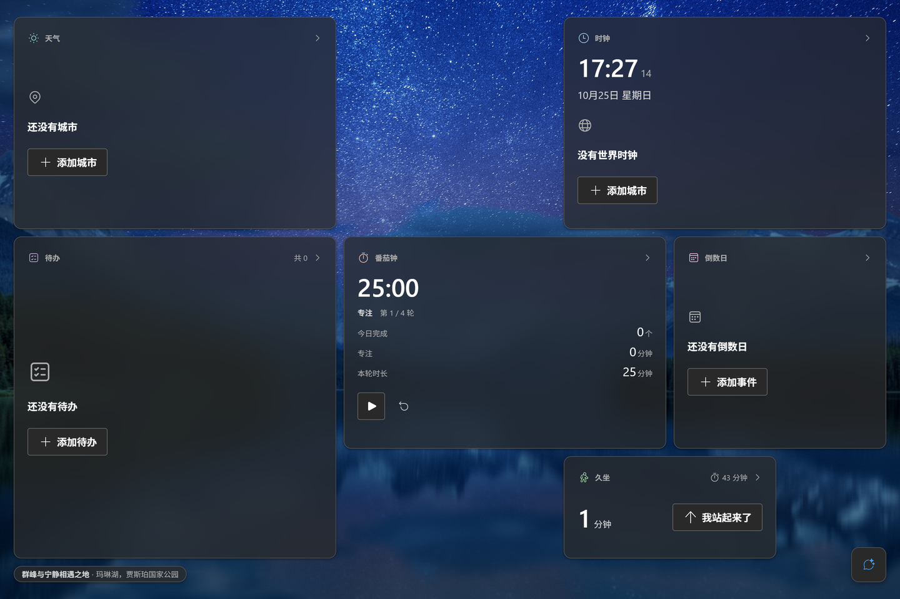

<p align="center"><sub>v0.6.0 · 1440×960 · 深色主题 · 必应每日壁纸（4K，填充）+ 磨砂卡片 · 20px identity 图标行 · 6 卡满屏构图与说明条 / chat 入口下缘共线（2026-10-25 真实安装版截图）</sub></p>

- 目标设备：Windows 10/11 平板（Windows 10 LTSC 实测）
- 设计：Fluent 2（控件/颜色/字阶/间距/动效全部 token 化）；Apple HIG 仅作原则参照
- 技术栈：Tauri 2 · Rust · React 19 · TypeScript · Vite 8 · Fluent UI React v9
- 形态：全屏无边框窗口；小组件 = 自包含 iframe 插件

## 特性

- **壁纸（v0.6.0：三模式 + 欣赏壁纸）**：数据层固定必应**官方归档**（`HPImageArchive`，4K 由 `urlbase + _UHD.jpg` 拼出，最多 15 天历史；归档接口缺 CORS 头，改由 Rust `reqwest` 代取 JSON）。三种互斥模式：**自动**（按本地日期选「不晚于今天」的最新一张，可关自动更新）、**固定**（钉住某张，跨天不跟）、**本机图片**（二进制存 IndexedDB、按内容哈希寻址，不联网）。比例不符按“填充”（`object-fit: cover`）不拉伸；左下角说明条同时是**欣赏壁纸**入口（全屏观图 + 一次性纯文本释义，会话内状态、不持久化）。释义由 **MiMo V2.6 Pro 看图 + 深度思考 + 强制联网搜索**生成：简体中文、禁任何语言来源旁白，提示词建议 ≤200 字（客户端不截断、不按长度判失败）；支持手动「重新生成说明」，失败保留旧释义。取不到时保留当前图或退回 Fluent 中性底色。
- **小组件桌面**：单一布局算法「网格 + 底部条（说明条 / 状态栏 / chat 入口）」——说明条与状态栏的实测高度取 max 作为 `H_p`，整块在视口内垂直居中；自适应网格、多页滑动、长按进入编辑模式（拖拽换位/改尺寸/删除/添加组件）、编辑删除持久化；布局、主题偏好都保存在本机。全屏页用磨砂底与层级契约，触控命中区统一 44px。
- **六个内置小组件**：时钟、倒数日、番茄钟、久坐提醒、待办、天气。同权视觉契约（D-36）：唯一 hero 字号 `Hero900`（40/52）、统一卡片栅格与材质、identity 色只允许出现在 20px 图标；每张卡有静态 identity 行（20px 图标 + 12px 组件名），空态为中性单色图标 + 主操作；默认布局按 8×5 满屏构图。
- **天气 3×2 为「当前天气 + 今日指标 + 逐时 6 列」三带式布局**，4×2 显示 AQI + 未来 7 天。
- **语音优先 Agent**：右下角浮空入口 → **半高纯语音窗** → 全高对话浮栏。点按或按住空格**立即开始说话**，回答自动朗读；语音回合结束后**停在半高窗继续下一轮**（不自动弹成全高），连续语音对话；文字对话是兜底，显式展开全高浮栏后才出现输入框。空格默认永远是按住说话（只有光标在输入框里才是打字）。语音音频只上传当轮一次，转写文字入库，后续上下文不再携带音频。v0.5.0 起补充轮次时间线、触控/语音混合手势、空闲自动收回与麦克风权限自愈。
- **插件系统**：每个插件是一个 `manifest.json` + 自包含页面，宿主通过 postMessage 暴露 8 个 API（配置、主题、尺寸、焦点、Agent 工具等）；可安装/启用/禁用，带可复制的插件模板。
- **蓝牙音箱（A2DP Sink）**：设置 → 常规 → 设备里的分组，把平板当手机的外放：蓝牙开关、已配对设备下拉、连接/断开；系统能力在宿主 Rust，Agent 有 `btAudio.status/devices/connect/disconnect` 四个内置工具。配对走 Windows/手机蓝牙设置，媒体信息与配对 UI 后置。
- **桌面底部状态栏**：桌面右下（Agent 入口左侧）一条状态栏，显示蓝牙音箱状态、主音量、电量/充电；下缘与说明条 / Agent 入口共线，材质同说明条。点蓝牙状态回设置页「常规 → 设备」。说明条高度与状态栏高度取 max 作为布局输入 `H_p`，隐藏说明条时状态栏仍撑住底部带。
- **宿主页面**：设置、复盘（使用统计/热力图）、插件管理；多个入口收进设置页，不占桌面。
- **无摄像头 / 无人脸 / 无唤醒词 / 无全屏语音页 / 无 dock**（v0.3.0 已全部移除）。

## 截图

> 截图取自 **2026-10-25 v0.6.0 验证轮**（真实安装版 1440×960 / 200% DPI：说明条按下形变、卡片 hover/press 本体缩放、欣赏壁纸中文释义）；v0.6.0 的壁纸三模式 / 欣赏壁纸 / 说明条参与布局已补图到 `docs/images/v060/`。历史版本截图（v030 / v037 / v040 / v050）仍保留在 `docs/images/` 作视觉存档。

### 桌面（v0.6.0：必应壁纸 + 磨砂卡片 + 说明条参与布局 + 满屏默认构图）

| 深色 · 1440×960（v0.6.0 真实安装版） | 亮色 · 1024×768（v0.5.0 留存） |
|---|---|
|  | 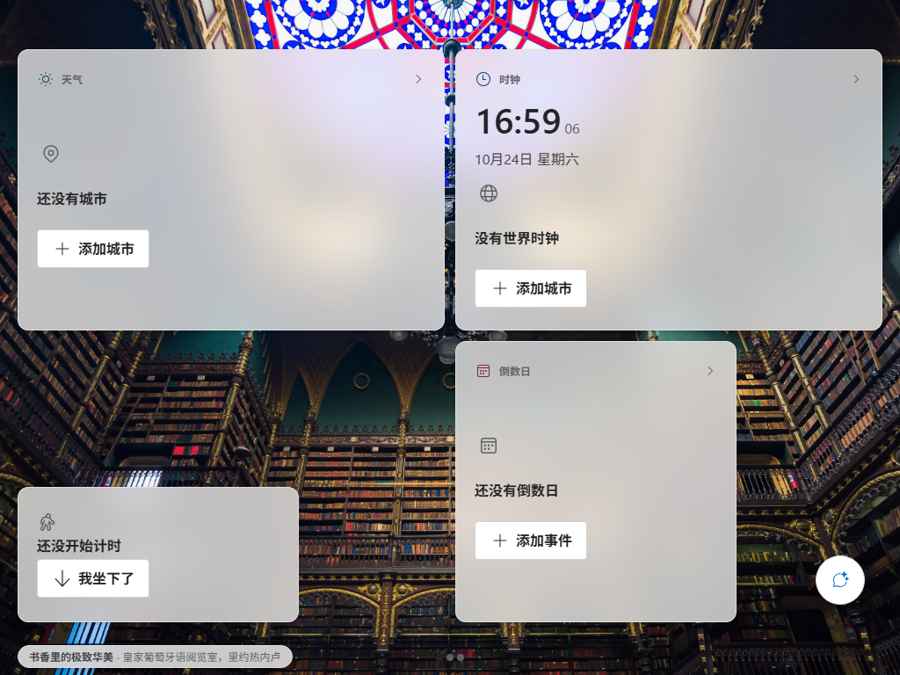 |
| <sub>4K 壁纸按“填充”铺满；卡片浮在壁纸上；左下角说明条（欣赏壁纸入口）与右下 chat 入口下缘共线</sub> | <sub>同一套 Fluent token，亮色下卡片为白色磨砂面；1024 宽下默认构图回退，部分卡片在后续页</sub> |

### 欣赏壁纸（v0.6.0：说明条入口 + 中文释义）

| 欣赏壁纸 · 深色 1440×960 |
|---|
|  |
| <sub>桌面与卡片退场，只留壁纸 + 左下角说明条；释义由 MiMo V2.6 Pro 看图 + 深度思考生成（简体中文、禁来源旁白，提示词建议 ≤200 字），右侧为手动「重新生成说明」按钮</sub> |

<details>
<summary>交互态截图（真实鼠标：卡片 hover/press 本体缩放、说明条按下形变）</summary>

| 卡片 rest / hover / press（卡片本体缩放） |
|---|
| 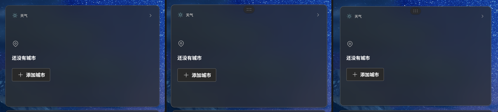 |
| <sub>hover 1.015（100ms 减速）、press 0.985（50ms 加速）；缩放只作用卡片本体，iframe 内容不参与，阴影/描边按 MOTION §2 升降</sub> |

| 说明条 rest / press（scale 0.985） |
|---|
| 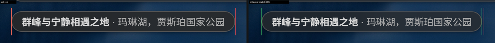 |
| <sub>按下 0.985 形变（50ms 加速 / 回弹 100ms）；transform 不改 border-box，H_p 仍 26，44×44 命中区不变</sub> |

</details>

### Agent：右下角浮空三段界面（语音优先）

| 半高语音窗 · 录音中（1440 深色） | 半高语音窗 · 回答后停留（1024 亮色） |
|---|---|
| 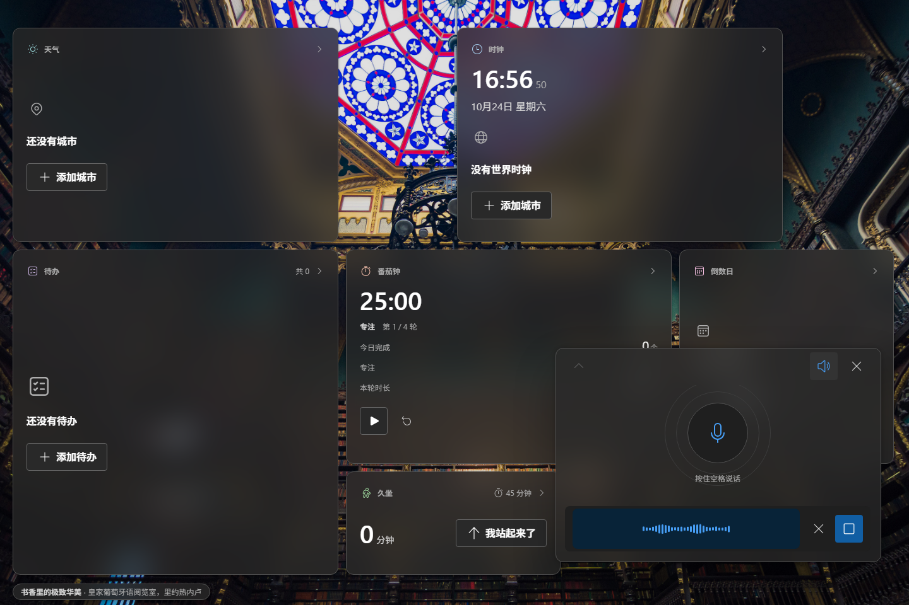 | 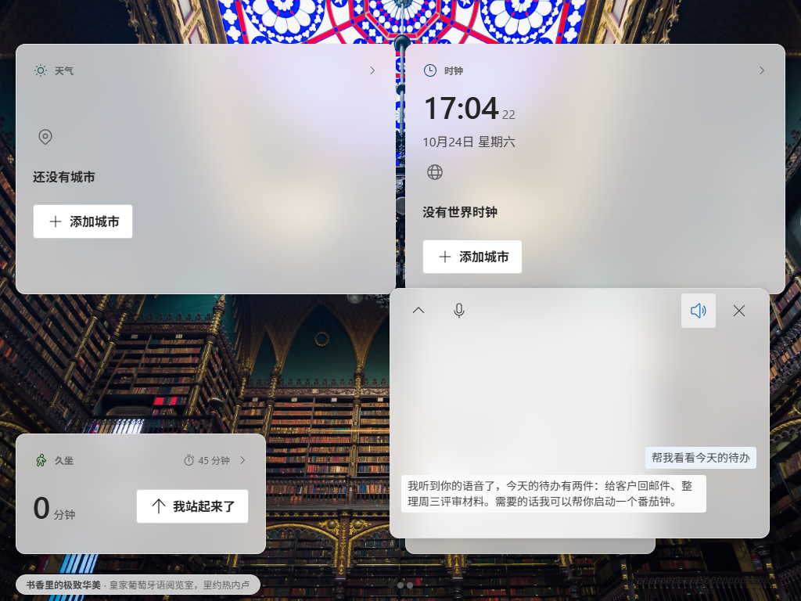 |
| <sub>纯语音形态：声纹 + 停止 / 取消，没有文字输入框；顶栏 ⌃ / 朗读 / ✕</sub> | <sub>语音回合结束不自动展开，peek 显示问答，可继续说下一轮</sub> |

| 半高语音窗 · 录音中（1024 亮色） | 全高对话 · 单行输入（1440 深色） |
|---|---|
| 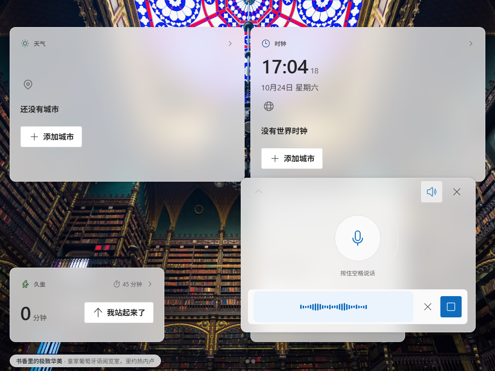 | 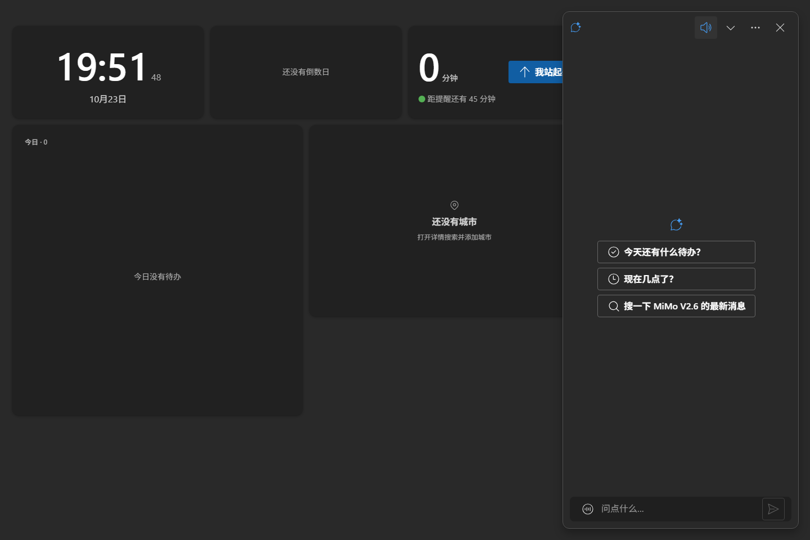 |
| <sub>点按 / 按住空格立即录音；1024 亮色下的半高窗</sub> | <sub>`[语音] [输入] [发送]` 一行；文字对话是兜底</sub> |

### 语音消息呈现

| 语音消息（声纹 + 文字） |
|---|
| 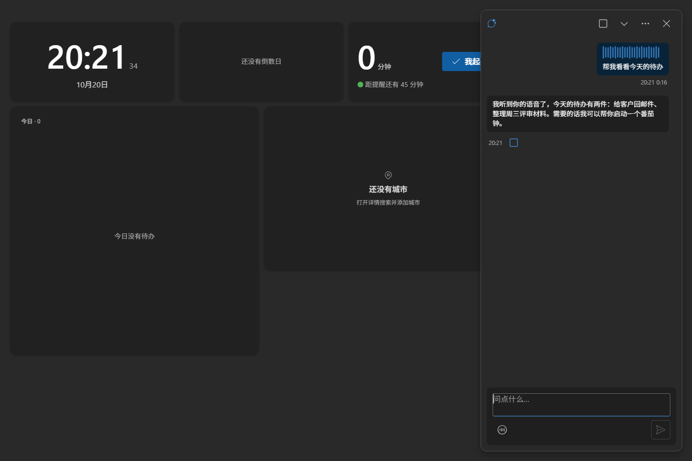 |
| <sub>不写「语音 / 转写结果」标签，靠声纹装饰表达</sub> |

### 天气 3×2 三带式

| 深色 | 亮色 |
|---|---|
| 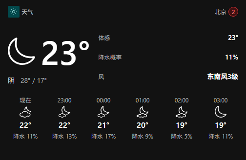 | 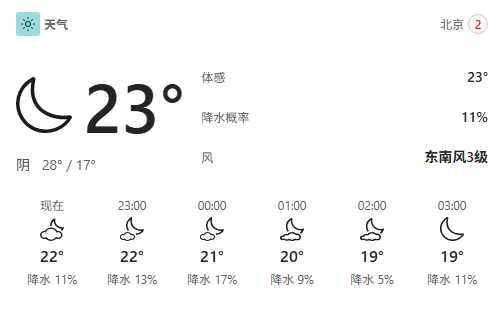 |
| <sub>identity 行（天气 + 城市）+ 当前天气 + 今日指标（体感/降水概率/风）+ 逐时 6 列</sub> | <sub>1024 下今日指标降为 2 项，不裁切</sub> |

<details>
<summary>2×2 / 4×2 对照</summary>

| 2×2 | 4×2 |
|---|---|
| 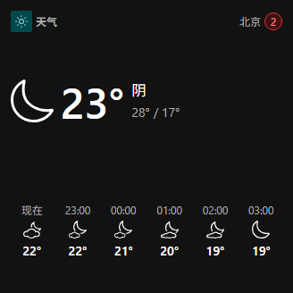 | 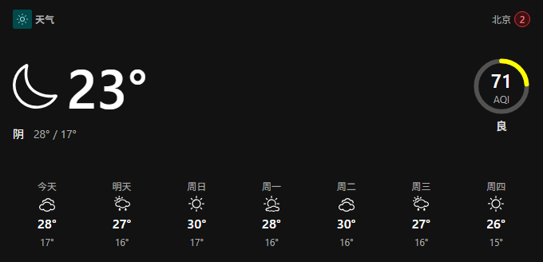 |

</details>

### 设置 / 入口

| Agent 设置 | 设置页「入口」组 |
|---|---|
| 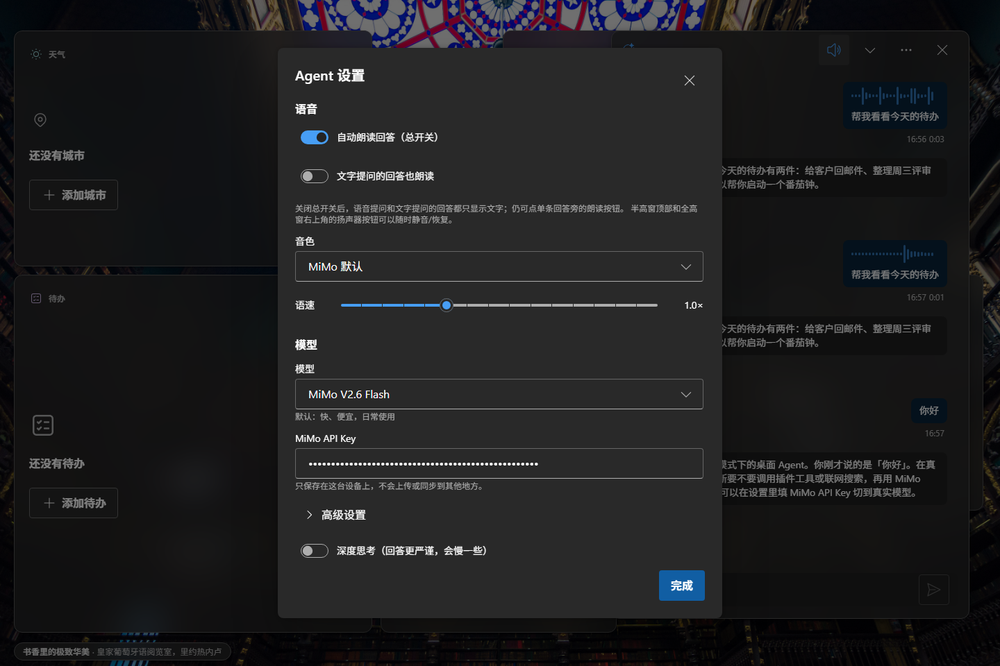 | 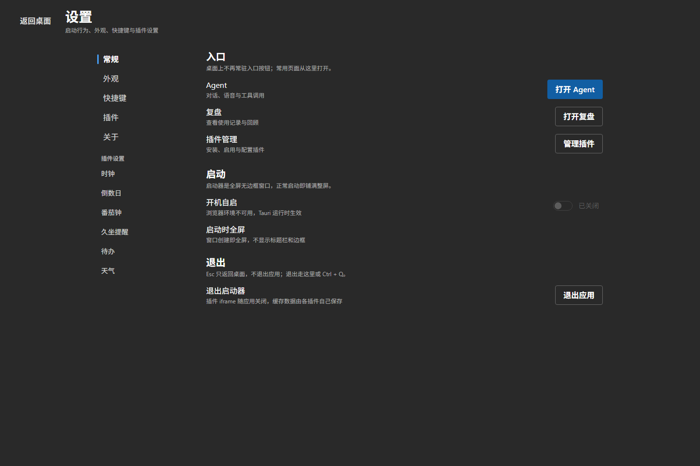 |
| <sub>语音（自动朗读总开关 / 文字提问也朗读）/ 模型 / 联网搜索</sub> | <sub>打开 Agent / 复盘 / 插件管理</sub> |

打开宿主设置的三条路径：**鼠标 = 桌面空白处右键 →「设置」**；键盘 = `Ctrl+,`；触控 = 长按桌面空白 → 编辑工具栏「设置」。宿主设置不会放进 Agent 的 `⋯` 菜单（Agent 菜单只放 Agent 自己的设置）。

<details>
<summary>减少动态效果（reduced-motion）状态</summary>

| 半高语音窗 · 回答后（减少动效） |
|---|
| 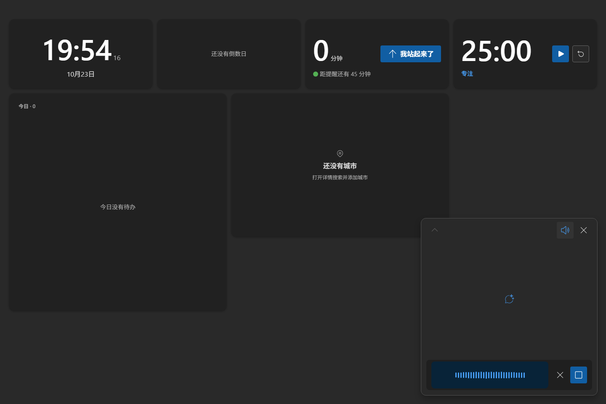 |
| <sub>只保留 120ms 透明度，不做尺寸/阴影/位移动画；声纹与脉冲静止</sub> |

</details>

## 语音优先 Agent

- **入口**：右下角 56×56 浮空按钮。点按 / 按住空格 / 点半高窗「点击说话」**立即开始录音**；松开或点停止结束并发送；录音中 Esc 取消。没有“先打开窗口再点录音”的中间步骤。
- **三段形态（语音优先，v0.3.7）**：按钮（56×56）→ 半高语音窗（420 × clamp(320px, 44vh, 440px)）→ 全高对话浮栏（420 × calc(100vh − 40px)）。右/下锚定，只变宽高，圆角恒 12px。
  - **半高窗是纯语音形态**：没有文字输入框；顶部 ⌃ 展开 / 朗读开关 / ✕ 收起，中部最近 3 条消息 peek，底部「点击说话」大按钮（录音中换成声纹条）。语音回合结束**留在半高窗**，回答会被朗读并显示在 peek 里，可立刻再说下一轮 = 连续语音对话。
  - **全高对话是文字兜底**：显式点 ⌃ / peek / Enter 才展开；头部 ⌄ 收起到语音窗、✕ 关闭；底部是单行输入区 `[语音] [输入框] [发送]`。⌄ 或 Esc 退回语音窗，✕ 直接回按钮；关闭后焦点回入口按钮。
- **默认行为（edge corner）**：空格默认永远是“按住说话”，只有光标主动落进全高输入框时才是打字；展开 / 收起 / 语音结束都不会把焦点塞进输入框（v0.3.7 修复“回答后按空格打出空格”）。输入框内按 Esc 先退出输入框，再按才退级。半高窗点外部收起（录音中除外），全高对话点外部不关闭。
- **音频与上下文**：当轮语音以 `input_audio` **原生发送给 MiMo 对话一次**；同一份 WAV 并行送 MiMo ASR，转写文字回填到消息并入库。音频 Blob 用完即弃：不写 localStorage、不进消息、不进后续上下文；重试/切会话/重启只发文字。ASR 30s 超时。
- **播报**：自动朗读总开关默认开；关闭后语音/文字回答都只显示文字（单条回答仍可手动朗读）。两个形态顶部都有扬声器按钮随时静音/恢复，「停止朗读」只在播放中出现；开始录音、换段或关闭窗口先停止播报。
- **语音消息呈现**：与打字消息同形同色；顶部 24 桶声纹装饰 + 转写 shimmer；不写「语音 / 转写结果如下」之类的文字标签。

## 安装

### 直接安装

从构建产物安装 `Windows Tablet Launcher`（NSIS 中文安装包或 MSI zh-CN）。v0.6.0 已在本机完成 `npx tauri build` 与 NSIS 静默**全新安装**（产物在 `src-tauri/target/release/bundle/{nsis,msi}/`；`release/` 里是 v0.4.0 及更早的历史归档）。升级会通过插件目录的 `.seed-version` 自动重种内置插件，用户布局/会话/插件配置保留。

首次启动后：

1. 打开设置：**鼠标在桌面空白处右键 →「设置」**；或 `Ctrl+,`；触控长按桌面空白 → 编辑工具栏「设置」。→ Agent：填 MiMo API Key（模型、语音使用同一 Key）。
2. 设置 → 插件 → 天气：填和风天气 API Key 与 API Host。
3. 需要联网搜索时，在 MiMo 控制台 → 插件管理开通 Web Search Plugin。
4. 需要把平板当蓝牙音箱时：先在手机或 Windows 蓝牙设置里与平板配对，然后设置 → 常规 → 设备 → 蓝牙音箱 → 选设备「连接」（也可以对 Agent 说「连一下蓝牙音箱」）。

### 从源码运行

环境：Windows 10/11、WebView2、Node.js 20+ 与 npm、Rust stable + MSVC Build Tools（Tauri 2 要求）。

```bash
npm install

npm run dev          # 只跑 Web 前端预览（浏览器）
npm run tauri dev    # 桌面窗口（Tauri）
npm run build        # 前端构建
npx tauri build      # 构建 release exe + NSIS/MSI 安装包
```

插件产物重建：

```bash
node scripts/build-plugin.mjs weather   # 构建单个插件到 public/plugins/weather/app/app.js
node scripts/build-plugin.mjs --all     # 构建全部插件
```

## 插件开发

一个插件就是一个目录：`public/plugins/<id>/`，自包含、可独立删除。

```text
public/plugins/<id>/
├── manifest.json     # id/名称/组件列表/尺寸档位/设置 schema/Agent 工具声明
├── index.html
└── app/app.js        # 构建产物（React + Fluent UI，或任意前端产物）
```

- 宿主通过 postMessage 提供 8 个 API：配置读写、主题、尺寸档位、焦点交接、打开浮层、宿主设置、Agent 工具注册、卡片手势转发。
- 复制 `templates/plugin-template/` 即可开始写新插件；模板自带构建产物，不参与运行时。
- Agent 能力 = 插件注册的工具；插件声明什么，Agent 就能做什么。

## 目录结构

```text
src/
├── host/
│   ├── desktop/        # 自适应网格、多页、编辑模式、卡片手势
│   ├── layout/         # 布局引擎与持久化（v3：widgets + pages + removed）
│   ├── plugins/        # 插件管理器、iframe、主题注入、浮层
│   ├── bridge/         # postMessage 协议与类型
│   ├── agent/          # 浮空界面、会话状态机、MiMo 对话/语音、工具调度
│   ├── pages/          # 设置 / 复盘 / 插件管理
│   └── shell/          # 路由、快捷键、主题、启动
├── styles.css
└── main.tsx
src-tauri/              # 窗口、系统能力、插件种子、协议
public/plugins/         # 六个内置插件 + 共享底座
templates/plugin-template/
docs/                   # 全部项目文档（现行规范 / 历史 / 发布 / 审计 / 第三方参考）：先看 docs/README.md
shots/                  # 验证证据：截图与日志（本地不入库；索引见 docs/audits/README.md）
.tmp/                   # 临时调试输出（本地不入库）
release/                # 本机安装包产物（本地不入库）
```

> 文档/证据/临时目录的分工见 **[docs/README.md](docs/README.md)**：`docs/` 根目录是现行规范的稳定入口
> （路径被源码注释引用），历史计划与规格在 `docs/history/`，发布记录在 `docs/releases/`，
> 审计报告在 `docs/audits/`，第三方参考资料在 `docs/reference/`。

## 文档

- **[docs/README.md](docs/README.md)** —— 文档总索引：阅读路径 / 目录布局 / 维护约定 / 迁移对照
- 现行规范：[VISION.md](docs/VISION.md) · [DESIGN.md](docs/DESIGN.md) · [FLUENT2.md](docs/FLUENT2.md) · [DENSITY.md](docs/DENSITY.md) · [MOTION.md](docs/MOTION.md) · [TOKEN-MAP.md](docs/TOKEN-MAP.md)
- 契约与决策：[PLUGIN-CONTRACT.md](docs/PLUGIN-CONTRACT.md) · [PLUGIN-REACT.md](docs/PLUGIN-REACT.md) · [AGENT-SURFACE-CONTRACT.md](docs/AGENT-SURFACE-CONTRACT.md) · [DECISIONS.md](docs/DECISIONS.md)
- 组件规格：[components/](docs/components/)（agent / clock / countdown / pomodoro / sedentary / todo / weather）
- 发布与验证：[RELEASE-REPORT.md](docs/releases/RELEASE-REPORT.md)（§10 v0.2.1 … §20 v0.3.7）· [RELEASE.md](docs/releases/RELEASE.md) 发布检查清单 · [审计与证据索引](docs/audits/README.md)
- 历史与参考：[history/](docs/history/)（开发计划、UI/浮层重写规格与结果）· [reference/](docs/reference/)（Fluent 2 / Apple HIG / 外部服务链接）

## 验证状态（v0.6.0）

> 代码版本 **v0.6.0**（`package.json` / `src-tauri/Cargo.toml` / `src-tauri/tauri.conf.json` 一致）。
> **v0.6.0 已完成验证（2026-10-25）**：`npx tsc --noEmit` / `npm run build` / `npx tauri build` 全部通过；
> NSIS 静默全新安装 + 清空 WebView2 配置后，在 1440×960 逻辑 / DPI192 下用真实鼠标截图确认
> 卡片本体 hover/press 缩放、说明条按下形变、说明文字为中文且不含来源旁白；CDP 断言 **47/47 PASS**。
> 证据是本地 `shots/acceptance-v060/`（`REPORT.md` / `checks.json` / 原始截图，按约定不入库）。
> v0.4.0 及以前有独立验证报告与截图；v0.4.5 / v0.5.0 未保留独立报告。

- v0.6.0（2026-10-25，壁纸三模式 + 欣赏壁纸 + 说明文字收口，D-37 / D-38）：壁纸改为必应**官方归档**（`HPImageArchive`，15 天历史、4K；归档接口缺 CORS 头，改由 Rust `reqwest` 代取 JSON，`src-tauri/src/bingarchive.rs` 注册到 `lib.rs`）；自动 / 固定 / 本机图片三模式互斥（本机图存 IndexedDB、按内容哈希寻址）；说明条改为按钮，同时是**欣赏壁纸**唯一入口（全屏观图，Esc/再点退出，会话内不持久化），并新增一次性释义（独立调用、强制 `web_search`、按内容地址缓存、失败 24h 冷静期）。**说明文字 v3（D-38）**：固定 `mimo-v2.6-pro`、开启深度思考，并把今日壁纸 4K 图片以 `image_url` 多模态消息随请求发送；SYSTEM_PROMPT 要求简体中文、禁任何语言来源旁白、建议 2–4 句 ≤200 字（长度只由提示词约束，客户端不截断）；客户端新增语言/旁白硬校验，命中即失败不落库；欣赏壁纸模式可手动「重新生成说明」（失败保留旧释义）。**动效收口**：说明条按下 `scale(0.985)` 形变（`H_p` 改 `offsetHeight` 测量，44×44 命中区不变）；hover/press/长按/编辑缩放全部回到 **Card 本体**，iframe 内容不参与（reduced-motion 无 transform）。**磨砂诊断**：真实 DPR2 截图实测 `backdrop-filter` 正常对壁纸合成（卡片区域 / 锐利壁纸 Laplacian 方差比 1.9e-05），`will-change`/`isolation` 移除前后像素 diff 0.0，非合成层截断；材质 72% + blur 24 维持 D-31 登记值。证据：本地 `shots/acceptance-v060/REPORT.md`。文档落点：DESIGN §6 / TOKEN-MAP §1·§6 / AGENT-SURFACE-CONTRACT §1·§14.1·§20 / MOTION §5.2 / FLUENT2 §5·§7·§14 / DECISIONS D-37·D-38。
- v0.5.0（2026-10-24，布局 / Agent / 插件 / 宿主收敛轮）：桌面布局收敛为「网格 + 底部条（说明条 / chat 入口）」单一算法；Agent 增加轮次时间线、「触控 + 语音」混合手势、空闲自动收回、麦克风权限自愈；宿主全屏页磨砂底与层级契约、44px 命中区垂直居中；插件卡片内对齐收敛到内容轴、时钟 Agent 工具收紧（先搜后加）；构建升级 Tauri 2.12.4 并修复 WebView2 权限，版本号统一 0.5.0。
- v0.4.5（2026-10-24，Equal Except Hue 视觉契约 + 布局居中，D-36）：唯一 hero 字号 `Hero900`（40/52，不定义项目级字号 token）、统一卡片栅格（padding 16 / gap 8 / 行高 44）、identity 色白名单且只出现在 20px 图标、按钮层级规则、统一卡框材质；`gridOrigin` 取消 4px 吸附改为严格居中（22/22/46/46）。验证：`npm run typecheck` exit 0；`npm run build` 通过（2227 modules）。

- v0.4.0（视觉返工，用户反馈"很素"）：**壁纸/材质层修复**——`FluentProvider` 根背景改透明、壁纸画在 provider 内部（v0.3.x 壁纸被 `colorNeutralBackground1` 实色盖住，`backdrop-filter` 一直在模糊纯色）；壁纸改用**必应每日壁纸 4K**（依次尝试 `api.bimg.cc` / `api-bimg-cc.apifox.cn` / 必应原生 JSON，UHD 3840×2160，`object-fit: cover` 填充不拉伸，`wtsl.wallpaper.v1` 缓存 12h，失败退回 Fluent 中性底色）；桌面左下角加壁纸说明（标题 + 地点短句）。卡片材质改 `colorNeutralBackground1` 72% + 模糊 + `colorNeutralStroke2` 描边；六插件加静态 identity 行与 identity 色（Fluent shared palette，≤10% 面积，D-32/D-33）与空态主操作；默认布局改为 8×5 满屏构图（35/40 格，D-34，另修了 `cell` 坐标被 `asWidgetSize` 误判的解析 bug）；Agent 半高窗 idle 加静态 voice mark（D-35）。
  验证：`npm run typecheck` / `npm run build` exit 0；六插件 `build-plugin.mjs --all` exit 0；`npx tauri build` exit 0；`verify-widgets.mjs` 六插件 dark+light **60/60 尺寸用例 PASS**（A 34、B 26）；`verify-agent-surface.mjs` **127/127 PASS**；`verify-agent-voice-first.mjs` 断言层全 PASS（198/200，2 条 FAIL 为并发环境 Edge teardown 竞态）；截图 `docs/images/v040/`。**不新增设计 token**：identity 色全部取 Fluent `colorPalette*`，brand 保持 Fluent 默认。

- v0.3.7 增量（用户反馈修复）：Agent 改为**语音优先**——半高窗成为纯语音形态（无文字输入框），语音回合结束**不再自动展开全高**（连续语音对话），全高对话只在显式展开后出现；空格默认永远是按住说话（修复“回答后按空格打进输入框”的根因：不再自动聚焦输入框）；全高对话的输入区改为单行 `[语音] [输入] [发送]`。视觉严格回到 Fluent 2 token（自造尺寸/圆角清零：语音主按钮用 `size=large`，间距/圆角/阴影/动效全取 token），交互按 HIG 思想收敛（入口长出/原路收回、关闭焦点回入口、✕ 关层 vs ⌄/Esc 退一级、peek 渐隐渐进披露、半高 detent、reduced-motion）。验证：新增 `scripts/verify-agent-voice-first.mjs` **198/198 PASS**（含“语音回合后观测不到 chat”“回答后空格再录音”“半高窗 textarea=0”“chat composer 单行三控件同轴”“窗口失焦取消任意路径录音”P2 回归）；`scripts/verify-agent-surface.mjs` **127/127 PASS**；`scripts/smoke-v031-ui.mjs` **26/26 PASS**；1440 dark / 1024 light / reduced-motion 三段 console error 0；`npm run typecheck` / `npm run build` exit 0；`npx tauri build` exit 0（cargo release 4m53s，NSIS + MSI 完成），产物在 `release/v0.3.7/`；证据 `shots/releases/v0.3.x/v037-dev/REPORT.md`。
- v0.3.6 增量（用户反馈修复）：**桌面小组件配置实时同步**——新增宿主 → 插件 `host:config` 增量推送，天气自动定位/城市/显示项、时钟/倒数日/番茄钟/久坐/待办等所有插件在 Tauri 打包版里改配置即时生效，不再需要重启。根因：宿主页（`tauri.localhost`）与插件 iframe（`wtsl.localhost`）跨 origin，旧的 storage 事件同步在打包版从未生效。验证：跨 origin harness before 复现 / after **PASS**（settings 34ms、places 58ms 同步，iframe `host:config` 6 条、console error 0）；独立审计 + diff 评审 P0/P1=0；六插件产物重建；`npm run typecheck` / `npm run build` exit 0；全量基线回归全绿（verify-plugin ×6 / overlays 6/6 / widgets 25/25 / plug-and-play 12/12 / sedentary 9/9，console 0）；**release 真窗口 CDP 38/38 PASS**（真实 WebView2：升级重种 0.3.5→0.3.6、时钟/天气设置页改动后跨 origin 卡片 2s 内更新、iframe 未 reload、console 0）。
- v0.3.5 增量：Agent 里说「我站起来了 / 我坐下了」**立即生效**（插件 `phrases` 由宿主直接执行，不再依赖模型调工具；语音先等 ASR 转写再发请求），卡片/详情无需再点按钮；久坐 UI 文案做减法（删除「休息中，坐下后开始新一轮」等状态机说明与每次操作的「已记录…」通知）。验证：短语单测 10/10；真实 MiMo + headless Edge 端到端 **12/12 PASS**；`scripts/verify-agent-surface.mjs` **109/109 PASS**。`node scripts/build-plugin.mjs sedentary`、typecheck、`npx tauri build` 全部 exit 0。
- v0.3.4 增量：久坐改为手动**「坐着 ↔ 站立」循环**——坐着点「我站起来了」、站立点「我坐下了」；久坐只累计坐姿，站立单独统计；提醒只在坐着时出现。Agent 新增 `standUp` / `sitDown` / `stats`（移除 `takeBreak`），复盘页按「起身次数」为主数值、久坐/站立分钟为次要指标。验证：`scripts/verify-sedentary.mjs` 坐→站→坐循环 **10/10 PASS**；复盘页集成检查 PASS（`sedentary.stats` 被发现并渲染）；`node scripts/build-plugin.mjs sedentary`、typecheck、`npx tauri build` 全部 exit 0。
- v0.3.3 增量：久坐**移除免打扰（quietHours）**——设置页不再有该分组、到阈值就提醒；旧配置字段由迁移自动删除。
- v0.3.2 增量：久坐改为**连续计时**（去掉「键鼠空闲判定起身」）；v0.3.4 起由「坐/站状态机」取代其中的连续计数口径。
- v0.3.1 增量：headless Edge 交互冒烟 **24/24 PASS、console error 0**（桌面右键菜单 → 设置页 / Agent 菜单边界、半高窗控制条 + peek + 展开、朗读总开关持久化、录音中收起停麦且无新消息），脚本 `scripts/smoke-v031-ui.mjs`。
- v0.3.0 基线：Agent 浮空界面独立 E2E 107/108（1 项判定测试采样时序），P1/P2 两个交互 bug 修复后复测 PASS；既有插件/浮层/plug-and-play/密度脚本全部 PASS。
- 天气 3×2：横向连续空白 166px → 16px（1024 下 12px），内容带/今日指标/Secondary/断点门禁通过。
- 真实 MiMo 音频冒烟：TTS 合成 → chat `input_audio`（HTTP 200，`audio_tokens` 与时长相符）→ ASR 回读与原文 100% 一致 → 后续纯文字请求无 `input_audio`。
- release exe + WebView2 CDP：v0.3.1 真窗口（标题 2.8s / 全屏 / `--webview-exe-version=0.3.1`）；升级种子 `.seed-version` 0.3.0 → 0.3.1、天气产物哈希与仓库一致；6 卡、8 iframe、无 dock/机器人、console 0；右键菜单→设置、未播放时的常驻朗读开关在真实 WebView2 内 16/16 checks PASS。
- 安装包（本机自用，含本地 Key，不外发）：v0.4.0 — NSIS 3,952,328 B / `85D483BC…`；MSI 5,156,864 B / `609830CA…`；`app.exe` 12,183,552 B / `E30FC6C4…`（对应 `release/v0.4.0/`，SHA-256 全表见该目录 `SHA256SUMS.txt`；旧版本产物在各自 `release/` 目录）。本机已用该 NSIS 静默升级安装并启动验证（窗口标题 `Windows Tablet Launcher`；运行时插件目录 6 个插件，无测试探针）。

## 已知限制与安全

- **密钥不进仓库**：`public/secrets.json` 与 `*.env` 等已在 `.gitignore` 中，从未被跟踪。可在设置页录入 Key，或使用本地 `public/secrets.json`（仅供本机构建/开发）。
- ⚠️ **构建会把本地 `secrets.json` 打进 `dist/` 与安装包**。如果要公开分发安装包，请先移除该文件或改为运行时录入，否则等于公开你的 MiMo / 和风天气 Key。
- 壁纸依赖必应官方归档联网取 4K 图（最多 15 天历史）；离线/接口失败时保留当前图，首次启动失败停在 Fluent 中性底色，不影响功能。本机图片不联网，且只存本机 IndexedDB（换机不同步）。
- 个人项目，未附开源许可证（默认保留所有权利）。
- 语音 ASR/TTS 依赖云端 MiMo，受网络与配额影响；不本地跑大模型。
- 不做唤醒词、常驻麦克风监听、人脸/摄像头；语音入口只有入口按钮、按住空格、「点击说话」与全高输入区语音按钮。
- Windows 10 LTSC 无 Mica/Acrylic 系统材质，界面用 Fluent 实色表面 + 阴影近似。
- 真实安装器安装/卸载路径与 release 内真实录音链路未纳入自动化，需手动验证。

## License

个人项目，未指定开源许可证（All rights reserved）。
