# Windows Tablet Launcher

给 Windows 平板用的全屏小组件桌面，外加一个内置的语音优先 Agent。  
没有应用图标、没有搜索框、没有开始菜单——开机就是整屏小组件，所有交互通过小组件和 Agent 直接完成。

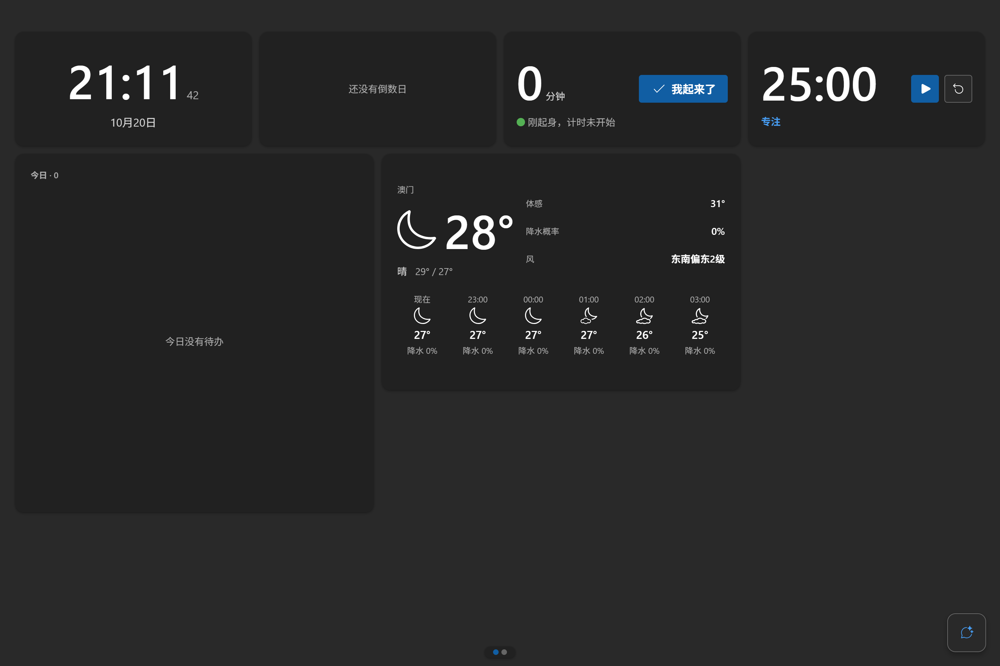

<p align="center"><sub>v0.3.7 · 1440×960 · 深色主题 · 六个内置小组件（右侧天气为 3×2 三带式）· 右下角为 Agent 入口</sub></p>

- 目标设备：Windows 10/11 平板（Windows 10 LTSC 实测）
- 设计：Fluent 2（控件/颜色/字阶/间距/动效全部 token 化）；Apple HIG 仅作原则参照
- 技术栈：Tauri 2 · Rust · React 19 · TypeScript · Vite 8 · Fluent UI React v9
- 形态：全屏无边框窗口；小组件 = 自包含 iframe 插件

## 特性

- **小组件桌面**：自适应网格、多页滑动、长按进入编辑模式（拖拽换位/改尺寸/删除/添加组件）、编辑删除持久化；布局、主题偏好都保存在本机。
- **六个内置小组件**：时钟、倒数日、番茄钟、久坐提醒、待办、天气。天气 3×2 为「当前天气 + 今日指标 + 逐时 6 列」三带式布局，4×2 显示 AQI + 未来 7 天。
- **语音优先 Agent**：右下角浮空入口 → **半高纯语音窗** → 全高对话浮栏。点按或按住空格**立即开始说话**，回答自动朗读；语音回合结束后**停在半高窗继续下一轮**（不自动弹成全高），连续语音对话；文字对话是兜底，显式展开全高浮栏后才出现输入框。空格默认永远是按住说话（只有光标在输入框里才是打字）。语音音频只上传当轮一次，转写文字入库，后续上下文不再携带音频。
- **插件系统**：每个插件是一个 `manifest.json` + 自包含页面，宿主通过 postMessage 暴露 8 个 API（配置、主题、尺寸、焦点、Agent 工具等）；可安装/启用/禁用，带可复制的插件模板。
- **宿主页面**：设置、复盘（使用统计/热力图）、插件管理；多个入口收进设置页，不占桌面。
- **无摄像头 / 无人脸 / 无唤醒词 / 无全屏语音页 / 无 dock**（v0.3.0 已全部移除）。

## 截图

### Agent：右下角浮空三段界面（语音优先）

| 入口按钮 | 半高语音窗 · 录音中 |
|---|---|
| 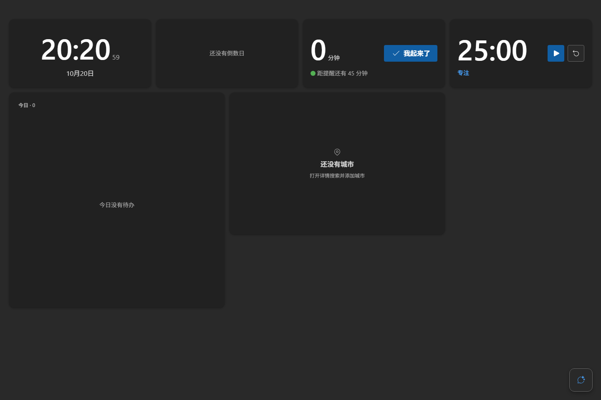 | 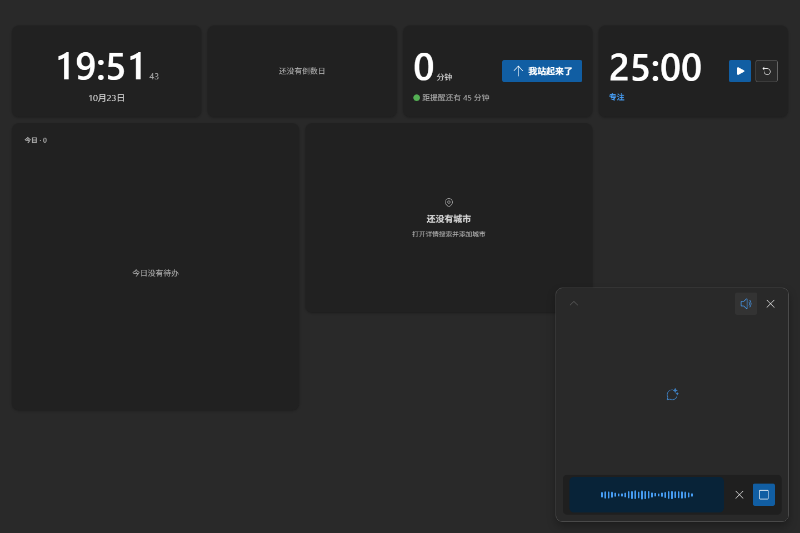 |
| <sub>点按 / 按住空格立即录音</sub> | <sub>纯语音形态：声纹 + 停止 / 取消，没有文字输入框</sub> |

| 半高语音窗 · 回答后停留 | 全高对话 · 单行输入 |
|---|---|
| 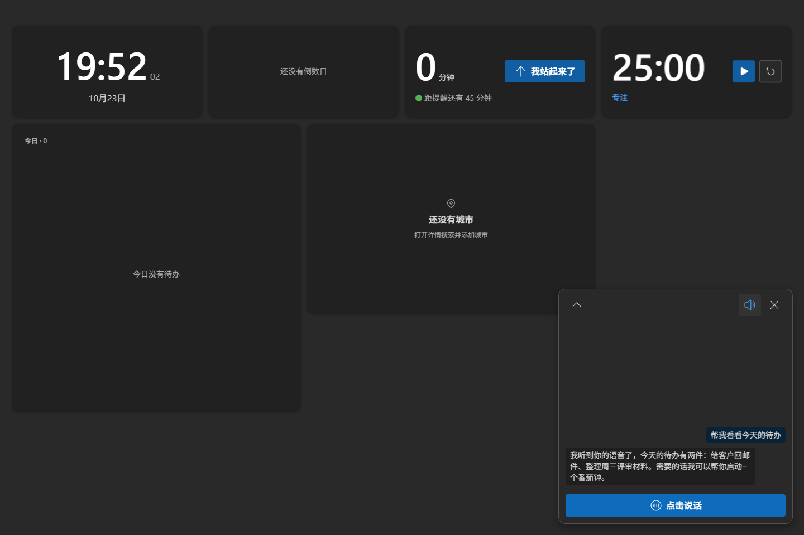 |  |
| <sub>语音回合结束不自动展开，peek 显示问答，可继续说下一轮</sub> | <sub>`[语音] [输入] [发送]` 一行；文字对话是兜底</sub> |

### 亮色 / 1024×768

| 半高语音窗 · 录音中 | 半高语音窗 · 回答后 | 全高对话 |
|---|---|---|
| 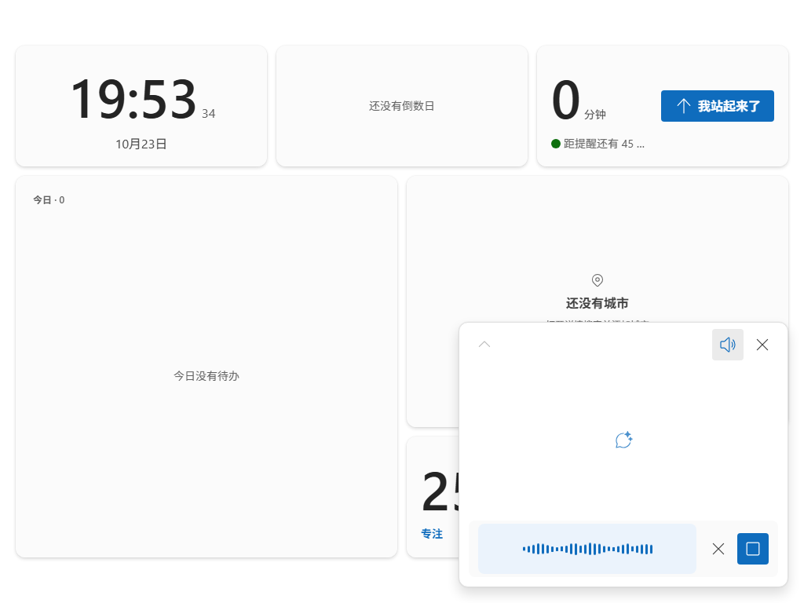 | 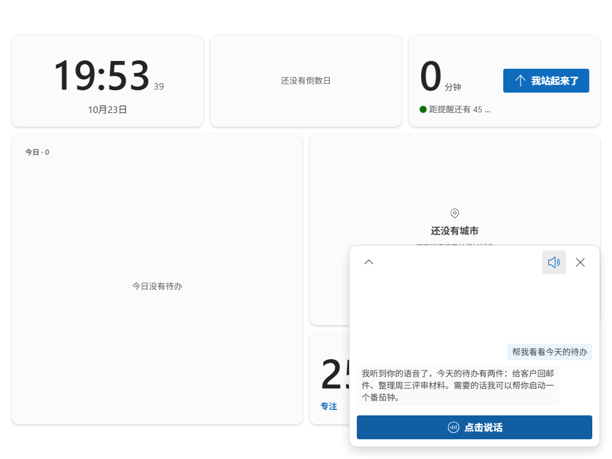 | 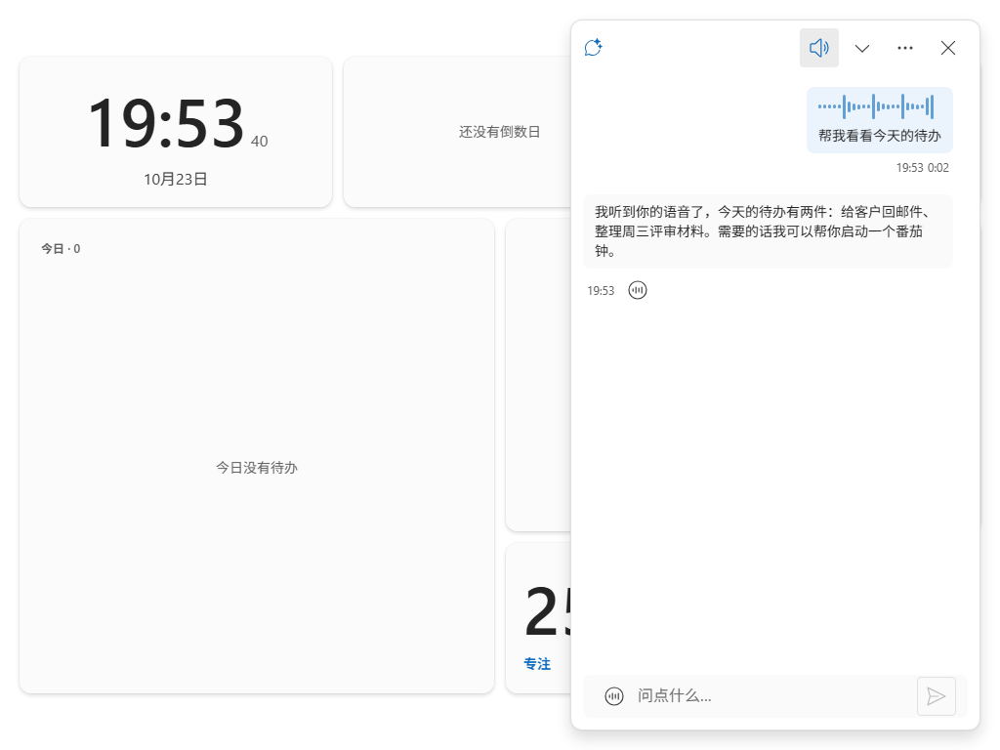 |

### 语音消息呈现

| 语音消息（声纹 + 文字） |
|---|
|  |
| <sub>不写「语音 / 转写结果」标签，靠声纹装饰表达</sub> |

### 天气 3×2 三带式

| 深色 | 亮色 |
|---|---|
| 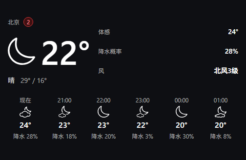 | 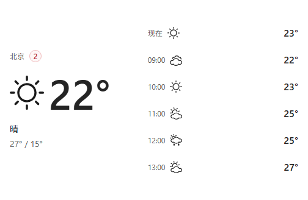 |
| <sub>当前天气 + 今日指标（体感/降水概率/风）+ 逐时 6 列（含降水概率）</sub> | <sub>1024 下今日指标降为 2 项，不裁切</sub> |

<details>
<summary>2×2 / 4×2 对照</summary>

| 2×2 | 4×2 |
|---|---|
| 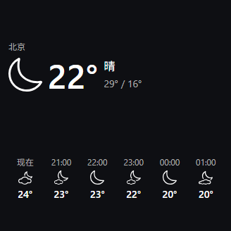 | 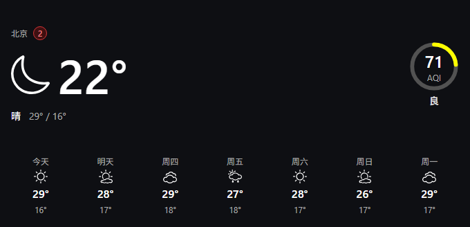 |

</details>

### 设置 / 入口

| Agent 设置 | 设置页「入口」组 |
|---|---|
| 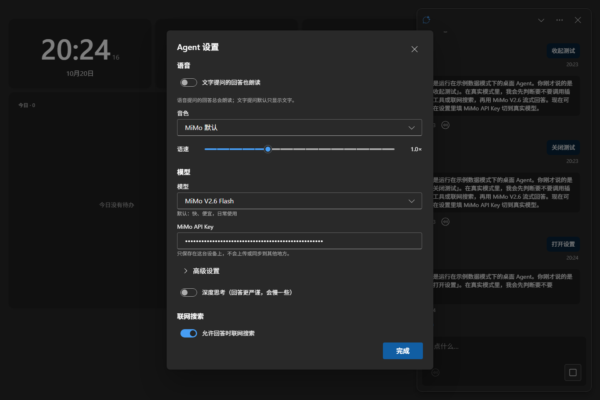 |  |
| <sub>语音（自动朗读总开关 / 文字提问也朗读）/ 模型 / 联网搜索</sub> | <sub>打开 Agent / 复盘 / 插件管理</sub> |

打开宿主设置的三条路径：**鼠标 = 桌面空白处右键 →「设置」**；键盘 = `Ctrl+,`；触控 = 长按桌面空白 → 编辑工具栏「设置」。宿主设置不会放进 Agent 的 `⋯` 菜单（Agent 菜单只放 Agent 自己的设置）。

<details>
<summary>减少动态效果（reduced-motion）状态</summary>

| 半高语音窗 · 回答后（减少动效） |
|---|
|  |
| <sub>只保留 120ms 透明度，不做尺寸/阴影/位移动画；声纹与脉冲静止</sub> |

</details>

## 语音优先 Agent

- **入口**：右下角 56×56 浮空按钮。点按 / 按住空格 / 点半高窗「点击说话」**立即开始录音**；松开或点停止结束并发送；录音中 Esc 取消。没有“先打开窗口再点录音”的中间步骤。
- **三段形态（语音优先，v0.3.7）**：按钮（56×56）→ 半高语音窗（420 × clamp(320px, 44vh, 440px)）→ 全高对话浮栏（420 × calc(100vh − 40px)）。右/下锚定，只变宽高，圆角恒 12px。
  - **半高窗是纯语音形态**：没有文字输入框；顶部 ⌃ 展开 / 朗读开关 / ✕ 收起，中部最近 3 条消息 peek，底部「点击说话」大按钮（录音中换成声纹条）。语音回合结束**留在半高窗**，回答会被朗读并显示在 peek 里，可立刻再说下一轮 = 连续语音对话。
  - **全高对话是文字兜底**：显式点 ⌃ / peek / Enter 才展开；头部 ⌄ 收起到语音窗、✕ 关闭；底部是单行输入区 `[语音] [输入框] [发送]`。⌄ 或 Esc 退回语音窗，✕ 直接回按钮；关闭后焦点回入口按钮。
- **默认行为（edge corner）**：空格默认永远是“按住说话”，只有光标主动落进全高输入框时才是打字；展开 / 收起 / 语音结束都不会把焦点塞进输入框（v0.3.7 修复“回答后按空格打出空格”）。输入框内按 Esc 先退出输入框，再按才退级。半高窗点外部收起（录音中除外），全高对话点外部不关闭。
- **音频与上下文**：当轮语音以 `input_audio` **原生发送给 MiMo 对话一次**；同一份 WAV 并行送 MiMo ASR，转写文字回填到消息并入库。音频 Blob 用完即弃：不写 localStorage、不进消息、不进后续上下文；重试/切会话/重启只发文字。ASR 30s 超时。
- **播报**：自动朗读总开关默认开；关闭后语音/文字回答都只显示文字（单条回答仍可手动朗读）。两个形态顶部都有扬声器按钮随时静音/恢复，「停止朗读」只在播放中出现；开始录音、换段或关闭窗口先停止播报。
- **语音消息呈现**：与打字消息同形同色；顶部 24 桶声纹装饰 + 转写 shimmer；不写「语音 / 转写结果如下」之类的文字标签。

## 安装

### 直接安装

从构建产物安装 `Windows Tablet Launcher`（NSIS 中文安装包或 MSI zh-CN；本机 `release/v0.3.7/` 为当前已构建产物）。升级会通过插件目录的 `.seed-version` 自动重种内置插件，用户布局/会话/插件配置保留。

首次启动后：

1. 打开设置：**鼠标在桌面空白处右键 →「设置」**；或 `Ctrl+,`；触控长按桌面空白 → 编辑工具栏「设置」。→ Agent：填 MiMo API Key（模型、语音使用同一 Key）。
2. 设置 → 插件 → 天气：填和风天气 API Key 与 API Host。
3. 需要联网搜索时，在 MiMo 控制台 → 插件管理开通 Web Search Plugin。

### 从源码运行

环境：Windows 10/11、WebView2、Node.js 20+ 与 npm、Rust stable + MSVC Build Tools（Tauri 2 要求）。

```bash
npm install

npm run dev          # 只跑 Web 前端预览（浏览器）
npm run tauri dev    # 桌面窗口（Tauri）
npm run build        # 前端构建
npx tauri build      # 构建 release exe + NSIS/MSI 安装包
```

插件产物重建：

```bash
node scripts/build-plugin.mjs weather   # 构建单个插件到 public/plugins/weather/app/app.js
node scripts/build-plugin.mjs --all     # 构建全部插件
```

## 插件开发

一个插件就是一个目录：`public/plugins/<id>/`，自包含、可独立删除。

```text
public/plugins/<id>/
├── manifest.json     # id/名称/组件列表/尺寸档位/设置 schema/Agent 工具声明
├── index.html
└── app/app.js        # 构建产物（React + Fluent UI，或任意前端产物）
```

- 宿主通过 postMessage 提供 8 个 API：配置读写、主题、尺寸档位、焦点交接、打开浮层、宿主设置、Agent 工具注册、卡片手势转发。
- 复制 `templates/plugin-template/` 即可开始写新插件；模板自带构建产物，不参与运行时。
- Agent 能力 = 插件注册的工具；插件声明什么，Agent 就能做什么。

## 目录结构

```text
src/
├── host/
│   ├── desktop/        # 自适应网格、多页、编辑模式、卡片手势
│   ├── layout/         # 布局引擎与持久化（v3：widgets + pages + removed）
│   ├── plugins/        # 插件管理器、iframe、主题注入、浮层
│   ├── bridge/         # postMessage 协议与类型
│   ├── agent/          # 浮空界面、会话状态机、MiMo 对话/语音、工具调度
│   ├── pages/          # 设置 / 复盘 / 插件管理
│   └── shell/          # 路由、快捷键、主题、启动
├── styles.css
└── main.tsx
src-tauri/              # 窗口、系统能力、插件种子、协议
public/plugins/         # 六个内置插件 + 共享底座
templates/plugin-template/
docs/                   # 需求/设计/组件契约/发布报告
```

## 文档

- [VISION.md](docs/VISION.md) —— 产品定位与边界
- [DESIGN.md](docs/DESIGN.md) / [FLUENT2.md](docs/FLUENT2.md) / [DENSITY.md](docs/DENSITY.md) —— 工程与设计规范
- [MOTION.md](docs/MOTION.md) / [AGENT-SURFACE-CONTRACT.md](docs/AGENT-SURFACE-CONTRACT.md) —— 动效与 Agent 浮空界面契约
- [components/agent.md](docs/components/agent.md) / [components/weather.md](docs/components/weather.md) —— Agent 与天气组件规格
- [PLUGIN-CONTRACT.md](docs/PLUGIN-CONTRACT.md) / [DECISIONS.md](docs/DECISIONS.md) —— 插件协议与关键决策
- [RELEASE-REPORT.md](docs/RELEASE-REPORT.md) —— 各版本验证报告（v0.3.0 §12 / v0.3.1 §13 / v0.3.2 §15 / v0.3.3 §16 / v0.3.4 §17 / v0.3.5 §18 / v0.3.6 §19 / v0.3.7 §20）

## 验证状态（v0.3.7）

- v0.3.7 增量（用户反馈修复）：Agent 改为**语音优先**——半高窗成为纯语音形态（无文字输入框），语音回合结束**不再自动展开全高**（连续语音对话），全高对话只在显式展开后出现；空格默认永远是按住说话（修复“回答后按空格打进输入框”的根因：不再自动聚焦输入框）；全高对话的输入区改为单行 `[语音] [输入] [发送]`。视觉严格回到 Fluent 2 token（自造尺寸/圆角清零：语音主按钮用 `size=large`，间距/圆角/阴影/动效全取 token），交互按 HIG 思想收敛（入口长出/原路收回、关闭焦点回入口、✕ 关层 vs ⌄/Esc 退一级、peek 渐隐渐进披露、半高 detent、reduced-motion）。验证：新增 `scripts/verify-agent-voice-first.mjs` **198/198 PASS**（含“语音回合后观测不到 chat”“回答后空格再录音”“半高窗 textarea=0”“chat composer 单行三控件同轴”“窗口失焦取消任意路径录音”P2 回归）；`scripts/verify-agent-surface.mjs` **127/127 PASS**；`scripts/smoke-v031-ui.mjs` **26/26 PASS**；1440 dark / 1024 light / reduced-motion 三段 console error 0；`npm run typecheck` / `npm run build` exit 0；`npx tauri build` exit 0（cargo release 4m53s，NSIS + MSI 完成），产物在 `release/v0.3.7/`；证据 `shots/v037-dev/REPORT.md`。
- v0.3.6 增量（用户反馈修复）：**桌面小组件配置实时同步**——新增宿主 → 插件 `host:config` 增量推送，天气自动定位/城市/显示项、时钟/倒数日/番茄钟/久坐/待办等所有插件在 Tauri 打包版里改配置即时生效，不再需要重启。根因：宿主页（`tauri.localhost`）与插件 iframe（`wtsl.localhost`）跨 origin，旧的 storage 事件同步在打包版从未生效。验证：跨 origin harness before 复现 / after **PASS**（settings 34ms、places 58ms 同步，iframe `host:config` 6 条、console error 0）；独立审计 + diff 评审 P0/P1=0；六插件产物重建；`npm run typecheck` / `npm run build` exit 0；全量基线回归全绿（verify-plugin ×6 / overlays 6/6 / widgets 25/25 / plug-and-play 12/12 / sedentary 9/9，console 0）；**release 真窗口 CDP 38/38 PASS**（真实 WebView2：升级重种 0.3.5→0.3.6、时钟/天气设置页改动后跨 origin 卡片 2s 内更新、iframe 未 reload、console 0）。
- v0.3.5 增量：Agent 里说「我站起来了 / 我坐下了」**立即生效**（插件 `phrases` 由宿主直接执行，不再依赖模型调工具；语音先等 ASR 转写再发请求），卡片/详情无需再点按钮；久坐 UI 文案做减法（删除「休息中，坐下后开始新一轮」等状态机说明与每次操作的「已记录…」通知）。验证：短语单测 10/10；真实 MiMo + headless Edge 端到端 **12/12 PASS**；`scripts/verify-agent-surface.mjs` **109/109 PASS**。`node scripts/build-plugin.mjs sedentary`、typecheck、`npx tauri build` 全部 exit 0。
- v0.3.4 增量：久坐改为手动**「坐着 ↔ 站立」循环**——坐着点「我站起来了」、站立点「我坐下了」；久坐只累计坐姿，站立单独统计；提醒只在坐着时出现。Agent 新增 `standUp` / `sitDown` / `stats`（移除 `takeBreak`），复盘页按「起身次数」为主数值、久坐/站立分钟为次要指标。验证：`scripts/verify-sedentary.mjs` 坐→站→坐循环 **10/10 PASS**；复盘页集成检查 PASS（`sedentary.stats` 被发现并渲染）；`node scripts/build-plugin.mjs sedentary`、typecheck、`npx tauri build` 全部 exit 0。
- v0.3.3 增量：久坐**移除免打扰（quietHours）**——设置页不再有该分组、到阈值就提醒；旧配置字段由迁移自动删除。
- v0.3.2 增量：久坐改为**连续计时**（去掉「键鼠空闲判定起身」）；v0.3.4 起由「坐/站状态机」取代其中的连续计数口径。
- v0.3.1 增量：headless Edge 交互冒烟 **24/24 PASS、console error 0**（桌面右键菜单 → 设置页 / Agent 菜单边界、半高窗控制条 + peek + 展开、朗读总开关持久化、录音中收起停麦且无新消息），脚本 `scripts/smoke-v031-ui.mjs`。
- v0.3.0 基线：Agent 浮空界面独立 E2E 107/108（1 项判定测试采样时序），P1/P2 两个交互 bug 修复后复测 PASS；既有插件/浮层/plug-and-play/密度脚本全部 PASS。
- 天气 3×2：横向连续空白 166px → 16px（1024 下 12px），内容带/今日指标/Secondary/断点门禁通过。
- 真实 MiMo 音频冒烟：TTS 合成 → chat `input_audio`（HTTP 200，`audio_tokens` 与时长相符）→ ASR 回读与原文 100% 一致 → 后续纯文字请求无 `input_audio`。
- release exe + WebView2 CDP：v0.3.1 真窗口（标题 2.8s / 全屏 / `--webview-exe-version=0.3.1`）；升级种子 `.seed-version` 0.3.0 → 0.3.1、天气产物哈希与仓库一致；6 卡、8 iframe、无 dock/机器人、console 0；右键菜单→设置、未播放时的常驻朗读开关在真实 WebView2 内 16/16 checks PASS。
- 安装包（本机自用，含本地 Key，不外发）：v0.3.7 — NSIS 3,936,298 B / `E6E6098D…`；MSI 5,144,576 B / `7C925253…`；`app.exe` 12,173,312 B / `33791E72…`（对应 `release/v0.3.7/`，SHA-256 全表见该目录 `SHA256SUMS.txt`；旧版本产物在各自 `release/` 目录）。

## 已知限制与安全

- **密钥不进仓库**：`public/secrets.json` 与 `*.env` 等已在 `.gitignore` 中，从未被跟踪。可在设置页录入 Key，或使用本地 `public/secrets.json`（仅供本机构建/开发）。
- ⚠️ **构建会把本地 `secrets.json` 打进 `dist/` 与安装包**。如果要公开分发安装包，请先移除该文件或改为运行时录入，否则等于公开你的 MiMo / 和风天气 Key。
- 个人项目，未附开源许可证（默认保留所有权利）。
- 语音 ASR/TTS 依赖云端 MiMo，受网络与配额影响；不本地跑大模型。
- 不做唤醒词、常驻麦克风监听、人脸/摄像头；语音入口只有入口按钮、按住空格、「点击说话」与全高输入区语音按钮。
- Windows 10 LTSC 无 Mica/Acrylic 系统材质，界面用 Fluent 实色表面 + 阴影近似。
- 真实安装器安装/卸载路径与 release 内真实录音链路未纳入自动化，需手动验证。

## License

个人项目，未指定开源许可证（All rights reserved）。
